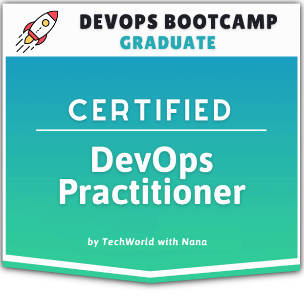

## Hi, I'm Danila Nagornyi — Software Engineer · Platform / DevOps

 

7+ years in software engineering, Tech Lead background.
I design cloud infrastructure (AWS), build CI/CD pipelines, containerize and run apps in Kubernetes,
and set up observability — with a strong understanding of what developers actually need from a platform.

- 🔭 Currently: Senior Software Engineer @ LodgeiT — frontend architecture + AWS infra (Terraform, ECS, GitHub Actions)
- 📚 Preparing for **AWS Certified Solutions Architect – Associate (SAA-C03)**
- 🎓 [Certified DevOps Practitioner](https://www.credly.com/go/kWb3uHky) — TechWorld with Nana DevOps Bootcamp

---

## ☁️ Cloud & Infrastructure

## ⚙️ CI / CD & Automation

## 📊 Observability

## 🖥️ Application Development

---

## 🚀 Featured projects

| Project | What it shows |
|---|---|
| [terraform-learn](https://github.com/DanilaNagornyi/terraform-learn) | AWS infrastructure as code with Terraform — VPC, subnets, security groups, EC2 |
| [eks-cluster-with-autoscaling](https://github.com/DanilaNagornyi/eks-cluster-with-autoscaling) | Amazon EKS cluster with Cluster Autoscaler |
| [helm-charts-microservices](https://github.com/DanilaNagornyi/helm-charts-microservices) | Helm charts for a 10-service microservices app (Online Boutique) |
| [prometheus-monitoring](https://github.com/DanilaNagornyi/prometheus-monitoring) | Prometheus + Grafana + Alertmanager stack for a microservices app in Kubernetes |
| [jenkins-shared-library](https://github.com/DanilaNagornyi/jenkins-shared-library) | Reusable Jenkins pipeline components for Docker & Maven projects |
| [ansible-aws-kubernetes](https://github.com/DanilaNagornyi/ansible-aws-kubernetes) | Configuration management with Ansible: EC2 provisioning, Kubernetes deploys |
| [python-automation-project](https://github.com/DanilaNagornyi/python-automation-project) | Python scripts for everyday DevOps automation (AWS, GitLab API, cleanup jobs) |

---

## 🧰 Also used

AWS ECS · EC2 · Lambda · S3 · RDS Aurora · IAM · ECR · Docker Compose · Nexus · DigitalOcean ·
Chromatic · Vercel · Jest · Webpack · Tailwind · Radix UI · React Query · Express · MongoDB · WebSocket

---

## 📈 GitHub Stats

  

